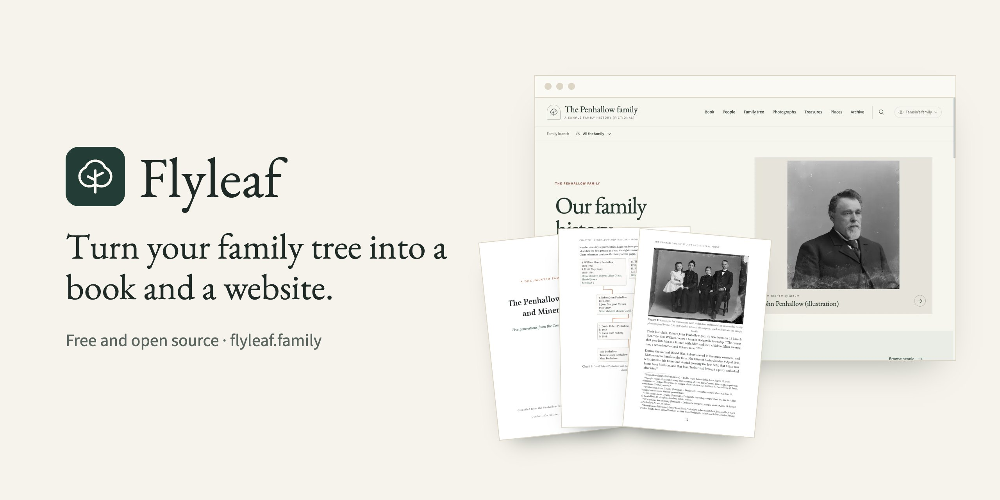

<p align="center">
  <a href="https://flyleaf.family"></a>
</p>

<p align="center">
  <a href="https://flyleaf.family/demo/">Demo</a> ·
  <a href="https://flyleaf.family/sample-book.pdf">Sample book</a> ·
  <a href="docs/README.md">Docs</a>
</p>

<p align="center">
  <a href="https://github.com/ian-c-leonard/flyleaf/actions/workflows/ci.yml"></a>
  <a href="LICENSE"></a>
</p>

Flyleaf turns a family tree into a printed family history and a family
website.

- **The book**: a chapter for each family line, an ancestor register, family
  charts, a bibliography and an index of names. In the register, each cited
  birth, baptism, christening, marriage, divorce, death, burial and
  cremation gets a footnote; other citations are listed by person in
  "Sources for the Register". A 6 × 9 inch PDF, ready to print.
- **The website**: the book online, a family tree, profiles, photographs,
  records, a map of places and family treasures. Public, or private to
  invited relatives.

Flyleaf builds the register, charts, index and website from a GEDCOM file,
which every genealogy program can export. You write the stories in each
chapter, by hand or with an AI assistant.

## Status

Flyleaf 0.1 is an early release. It grew out of one family's history: a
book of 1,123 pages about 617 people, and a private website for their
relatives. It is tested on a made-up sample family, on a new family started
from scratch, and on public trees exported by other programs. Other trees
will still find rough edges. Please report them.

The book's own wording is English and follows American conventions, those of
the NEHGS *Guide to Genealogical Writing*. Names and places print as the
tree holds them.

## Who it is for

Flyleaf suits a family historian who is at home on the command line, or who
works with an AI coding assistant. You install six tools, keep settings in
a JSON file, and write the stories in Typst, a short markup language. A
private website with sign-in also needs accounts with Cloudflare and Clerk.

## What the build checks

Flyleaf checks the stories' citations, but it cannot prove that every fact
is cited. The book build stops if a story cites a source the tree does not
have, or uses markup outside a short list. It also looks for the problems
below, without stopping. `flyleaf coverage` prints them:

- a paragraph of more than 90 words with no citation;
- a sentence that gives a year and cites nothing;
- a year that is not in the records of the people a story covers;
- a name one letter away from a name in the tree, which the tree never uses;
- words of certainty, such as "undoubtedly";
- style slips, such as month-first dates and "I" or "my";
- in the tree, a two-letter state code (such as CA) or a comment in a place
  name.

[Writing the book](docs/book.md#what-the-build-checks) gives the full list.
A warning does not stop the build. Read each story against the records.

With a fixed build date (`SOURCE_DATE_EPOCH`), the same time zone (`TZ`)
and the same Typst version, the same files make the same PDF, byte for byte.

## Requirements

Flyleaf runs on macOS and Linux. On Windows, use it inside WSL 2 (the
Windows Subsystem for Linux).

- git and make
- Python 3.11 or later
- Node.js 22.13 or later
- [Typst](https://typst.app) 0.14.2
- Poppler

## Quick start

```sh
git clone https://github.com/ian-c-leonard/flyleaf.git
cd flyleaf
python3 -m venv .venv && .venv/bin/pip install -r requirements.txt
(cd website && npm ci)
./flyleaf doctor

./flyleaf new ../my-family --name "The Example family" \
  --maintainer "Your Name" --email you@example.com
./flyleaf import my-tree.ged --family ../my-family --root "Your Name"
./flyleaf scaffold --family ../my-family
./flyleaf book --family ../my-family
./flyleaf site dev --family ../my-family
```

The [quick start](docs/quick-start.md) explains each step. It also explains
how to publish: privately for your relatives, or as a public site. A build
to publish stops for people who may be living until you choose. Keep the
family's folder beside Flyleaf's, as above, and use one copy of Flyleaf for
each family: the site build writes into Flyleaf's own `website/` folder. The
`sample/` folder holds the Penhallows, the made-up family in the demo.

## Documentation

Start with the [quick start](docs/quick-start.md), then
[from a tree to a finished book](docs/journey.md), which walks through the
whole process.

Flyleaf also ships the method its first book was made with, in full:

- [research standards](docs/research-standards.md) and a
  [research playbook](docs/research-playbook.md);
- guides to [living relatives](docs/relatives.md) and
  [photographs and documents](docs/photos-and-documents.md);
- a [style guide](docs/style-guide.md) that follows the NEHGS *Guide to
  Genealogical Writing*;
- [reviewing before you share or print](docs/review.md), with reviewer
  prompts for an AI assistant.

A new family folder holds `AGENTS.md`, which tells an AI assistant how to
work on it, and a plan and research log to fill in. The [docs](docs/README.md)
list every guide.

## Contributing

See [CONTRIBUTING.md](CONTRIBUTING.md) and the
[code of conduct](CODE_OF_CONDUCT.md). [ROADMAP.md](ROADMAP.md) lists what
may come next, and [CHANGELOG.md](CHANGELOG.md) what has changed.

## License

MIT. Flyleaf also ships fonts, map data and a PDF reader made by others,
under their own licences; [NOTICE](NOTICE) lists each one. The sample
family's photographs come from the Library of Congress, with no known
restrictions on publication; see `sample/images/CREDITS.md`.

To report a security problem privately, see [SECURITY.md](SECURITY.md).
